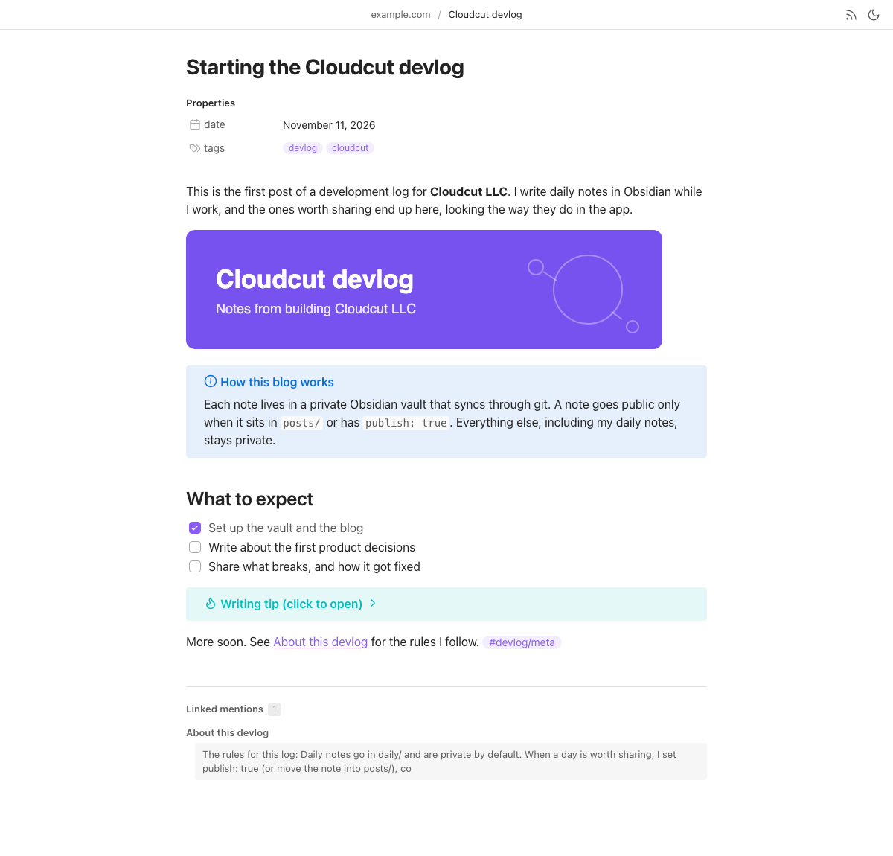
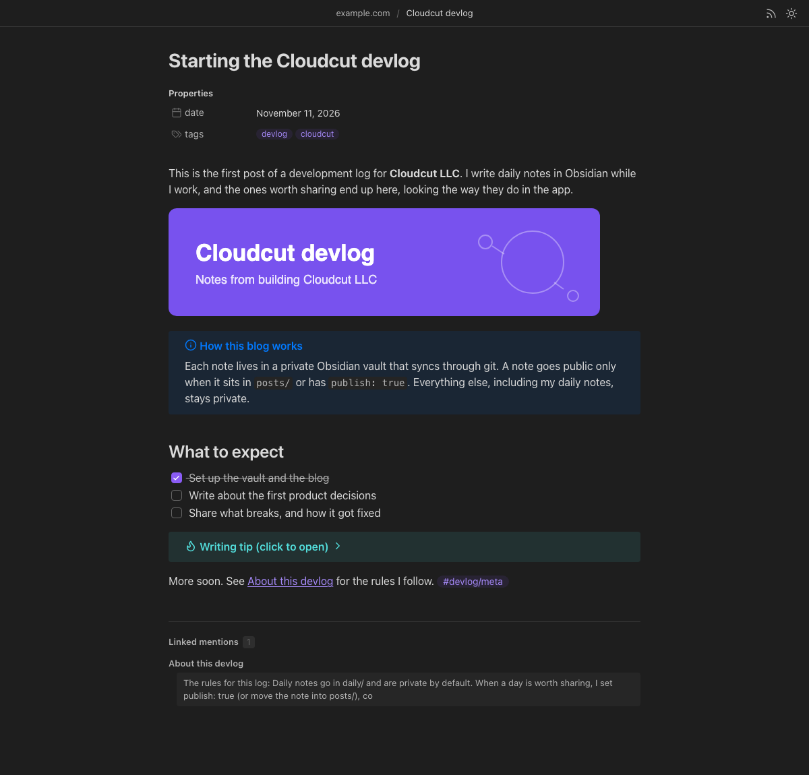
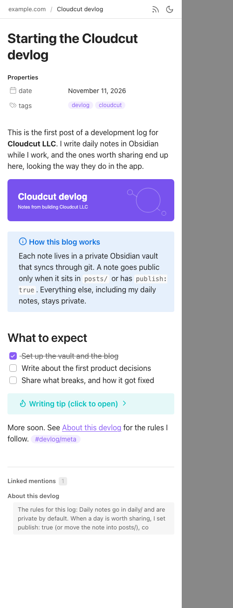

# site-engine

A small static-site builder for a personal site. It copies a content folder as is, and turns an
[Obsidian](https://obsidian.md) vault into a blog that looks like Obsidian's default reading view, in light and dark.

| Light | Dark | Phone |
|---|---|---|
|  |  |  |

The site's own content (pages, images, settings) lives in a separate, private repo. The vault is a third repo.
This repo holds only the engine, so it can be public.

```
content repo (private)          vault repo (private)            site-engine (this repo, public)
  site/        -> copied as is    posts/, daily/, attachments/    build.mjs
  blog.config.json                 notes with publish: true        lib/ (markdown, blog, templates)
                                                                   blog/theme/ (obsidian.css, theme.js)
                        \                  |                      /
                         `--- node build.mjs --content … --vault … --out dist ---> dist/ (S3 + CloudFront)
```

## Use

Needs Node 20 or later.

```sh
npm ci
npm test
node build.mjs --content <content-dir> --vault <vault-dir> --out dist --site-url https://example.com
```

- `<content-dir>/site/**` is copied to `dist/` unchanged.
- With `--vault`, published notes become `dist/blog/`: an index (newest first), one page per post at
  `/blog/<slug>/`, tag pages at `/blog/tags/<tag>/`, an Atom feed at `/blog/feed.xml`, and the blog's URLs are
  added to `dist/sitemap.xml` if the content has one. Pages use folder URLs (`/blog/<slug>/index.html`).
- `<content-dir>/blog.config.json` sets `title`, `description`, `siteName` (shown in the header breadcrumb),
  `homeUrl`, `base` (default `/blog`), `siteUrl` and `allowHtml` (default false). `--blog-title` and
  `--blog-description` override it.
- `stylesheets` in `blog.config.json` is a list of extra CSS files loaded after the built-in Obsidian theme on
  every blog page, for example `["/assets/blog-theme.css"]`. Use it to make the blog match the rest of a site
  (colours, fonts, header) without changing the engine. Paths are served from the content's own files.
- `indexStyle` in `blog.config.json` picks the look of the blog's front page. `"default"` (or leaving it out) is
  the title, the description, every post with its date, tags and summary, and a tag cloud. `"simple"` is only the
  title as the page heading (set `"title": "Blog"` for a page that says Blog), then each post as its title in bold
  (a link to the post) with a short preview under it, and a full-width divider line between posts. No description,
  dates, tags or tag cloud on that page; post pages, tag pages and the feed are unchanged.
- `theme` in `blog.config.json`: `"auto"` (or leaving it out) follows the reader's system setting and puts a
  light/dark button in the header. `"light"` or `"dark"` gives one fixed theme: the button and `theme.js` are left
  out, and the `obsidian.css` written to the output has no `prefers-color-scheme` rule and (for `"light"`) no dark
  values at all. If the site's own stylesheet (see `stylesheets`) has dark rules, remove those too.
- `tags` in `blog.config.json`: leave it out (or `true`) for tags as described below. `"tags": false` switches tags
  off for the whole blog: no tag chips on the index or in a post's Properties block, no tag cloud, no
  `/blog/tags/...` pages (none are written, linked or added to the sitemap), no categories in the feed, and a
  `#tag` written in a post shows as plain text. The notes in the vault keep their tags; nothing there changes.
- `feedTitle` in `blog.config.json` names the Atom feed (default: `title`). Useful when `title` is just "Blog".
- `feed` in `blog.config.json`: leave it out (or `true`) for the Atom feed. `"feed": false` writes no
  `/blog/feed.xml` and removes the feed icon from the header and the feed link from every page's head. With
  `"feed": false` and a fixed `theme`, the header holds only the breadcrumb links back to the site.

### Daily notes as posts

Five more settings in `blog.config.json` let a vault publish its daily notes just as they are written, with no
front matter. All are off unless set, so an existing site builds exactly as before.

| Setting | Default | What it does |
|---|---|---|
| `publishFolders` | `["posts"]` | Top-level vault folders whose notes are public without `publish: true`. `["posts", "daily"]` publishes every daily note. A note with `publish: false` or `draft: true` still stays out. |
| `dateFormat` | `"MM-DD-YYYY"` | How a date with the year last is read, in a file name or a `date` property: `"MM-DD-YYYY"` (11-13-2026 is November 13), `"DD-MM-YYYY"` (13-11-2026 is November 13) or `"YYYY-MM-DD"` (year-last names are not dates). Year-first dates (2026-11-13) are understood with every setting. A date that cannot exist (month 13, February 30) stops the build with the file's name; so does a value that is not one of the three. |
| `autoTitle` | `false` | `true`: a note with no `title` property takes its title from a `# heading` on its first line (the line is then not repeated in the body), and a note named only by a date gets the date written out ("November 13, 2026"). Otherwise the title is the file name. |
| `lineBreaks` | `false` | `true`: a single line break inside a paragraph shows as a line break, as Obsidian shows it (its *Strict line breaks* setting is off by default). `false` joins the lines, as standard Markdown does. |
| `failOnMissing` | `false` | `true`: the build stops when a published note points at an image or file that is not in the vault, listing every note and target. `false`: the build prints a warning for each and the page shows the file's name as grey text. |

```json
{ "publishFolders": ["posts", "daily"], "dateFormat": "MM-DD-YYYY", "autoTitle": true, "lineBreaks": true, "failOnMissing": true }
```

With these, `daily/11-13-2026.md` holding nothing but text becomes `/blog/11-13-2026/`, titled "November 13, 2026",
sorted by that date. **Everything written in a publish folder is public on the next build** unless the note says
`publish: false` or `draft: true`.

Matching Obsidian settings for the vault (Settings → Files and links): *Default location for new attachments* =
a folder such as `assets`, *New link format* = *Relative path to file*, *Use [[Wikilinks]]* = off. A pasted image is
then saved as `assets/Pasted image 2026….png` and written as ``, which
shows in Obsidian, on GitHub and on the blog.

Try it with the bundled example: `npm run build:example`, then `cd examples/dist && python3 -m http.server 8000`
and open http://localhost:8000/blog/. Add `?theme=dark` or `?theme=light` to a blog URL to preview a theme
(only with `"theme": "auto"`, the default; a fixed theme ignores it).

## Blog rules

A note is published only if it is in `posts/` (or another folder named in `publishFolders`) or its properties say
`publish: true`, and never if they say `publish: false` or `draft: true`. `templates/`, `.obsidian/`, `.trash/` and other dot-folders are never read.

Everything that points at another note is resolved against the published notes only:

| In the note | Published target | Private or missing target |
|---|---|---|
| `[[Note]]`, `[[Note|alias]]`, `[[Note#Heading]]` | link to `/blog/<slug>/#heading` | plain text |
| `[text](Note.md)`, `[text](../daily/Note.md)` | link | plain text |
| `[text](../assets/file.pdf)`, ``, `[[file.pdf]]` | link to the file, copied to `/blog/assets/` | plain text (reported as missing) |
| `![[Note]]` | the note, embedded (one level) | nothing |
| `![[image.png]]`, `![[image.png|300]]`, ``, `` | image, copied to `/blog/assets/` with a content hash | the file's name as grey text (reported as missing) |
| backlinks ("Linked mentions") | listed | never listed |

Attachments are copied only when a published note uses them. A file is looked up by its path from the note's own
folder, then from the vault root, then by its name anywhere in the vault; `%20` escapes, spaces and non-English
letters in file names all work. The copy is named `<name-as-slug>-<hash>.<ext>`, so its address never has spaces.
A file that is not found is listed in the build output; `"failOnMissing": true` makes that an error. `%%comments%%` are removed. Raw HTML in a note is
escaped unless `allowHtml` is on.

The slug is the `slug` property or the file name (`My Post.md` → `my-post`, `11-13-2026.md` → `11-13-2026`). The date
is the `date` property, or a daily-note file name (`YYYY-MM-DD` or `MM-DD-YYYY`; `dateFormat` changes how a year-last
name is read), or the file's modified time. Posts are listed newest first by that date. The title is the `title`
property or the file name (`autoTitle` adds the first-line heading and the written-out date).

## The Obsidian look

`blog/theme/obsidian.css` is written from scratch for this project. It uses the default theme's variable values
(base colors, accent `hsl(258 88% 66%)`, heading scale, 700px line width, the system font stack) and the same class
names Obsidian uses for the reading view, so most Obsidian CSS snippets apply too. It covers headings, lists, task
lists, tables, code blocks, quotes, highlights, tags (also nested `#a/b`), callouts (every standard type and alias,
`-`/`+` folding with no JavaScript), the Properties block, embeds and "Linked mentions". The callout icons are
[Lucide](https://lucide.dev) icons (ISC license), the set Obsidian uses. Light and dark follow the system; the
header button switches and remembers the choice in `localStorage` (`theme.js`). A site can instead fix one theme
with `"theme": "light"` or `"dark"` (see Use): the parts of `obsidian.css` between the `theme-switch` and
`theme-dark` marker comments are then cut from the output by `fixedThemeCss` in `lib/blog.mjs`. No fonts or
scripts load from other sites.

Not supported yet: Mermaid, math, Dataview, block references (`^id`), canvas files and a graph view.

## Automatic rebuilds

`templates/github/site-build.yml` is a GitHub Actions workflow for the content repo. It checks out the content repo,
this engine and the vault (with a read-only deploy key), runs the tests, builds, and uploads `dist` as an artifact.
Its deploy job (S3 sync and CloudFront invalidation through an OIDC role) runs only when the repo variable
`DEPLOY_ENABLED` is `true`. The vault triggers it with a `repository_dispatch` event called `devlog-updated`.
Setup steps are in [docs/blog.md](docs/blog.md). The deploy job names no GitHub `environment`, so that an AWS role can be
locked to the content repo's `main` branch.

This repo has no workflow of its own. Releasing it means pushing it to GitHub **before** the content repo that
depends on the change: [docs/release.md](docs/release.md).

## Files

| Path | What it is |
|---|---|
| `build.mjs` | Command line entry point: copies the content, builds the blog, updates the sitemap |
| `lib/blog.mjs` | Reads the vault, applies the publish rule, resolves links, writes pages, tags, feed, assets |
| `lib/markdown.mjs` | markdown-it with Obsidian syntax: wikilinks, embeds, tags, callouts, tasks, highlights, comments |
| `lib/templates.mjs` | Page HTML: header, inline title, Properties, note, Linked mentions; index (default and simple), tag pages, Atom feed |
| `lib/icons.mjs` | Lucide icons for callouts |
| `blog/theme/` | `obsidian.css` and `theme.js`, copied into `dist/blog/` |
| `test/` | `node --test` suite and a fixture vault full of private notes that must not leak |
| `examples/content/` | A tiny content folder for trying the build |
| `templates/github/site-build.yml` | The build-and-deploy workflow for the content repo |
| `docs/blog.md` | How to write and publish a post, and the one-time setup of the vault, the token and the variables |
| `docs/release.md` | How a change to this engine reaches a site: push order, checklist, pinning, rollback |
| `tools/make-png.py` | Writes small solid PNGs for fixtures, with no dependencies |

## License

[MIT](LICENSE)
